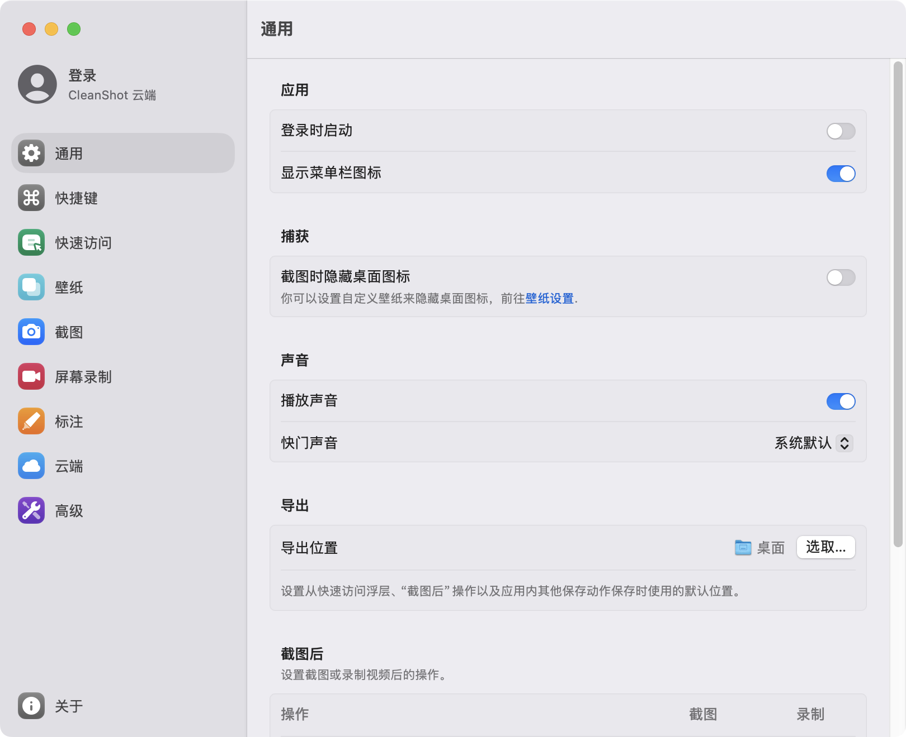

# CleanShot X 简体中文语言包

给 [CleanShot X](https://cleanshot.com) 加一份**非官方**简体中文界面。

**纯语言资源替换** —— 不修改任何可执行文件、不注入任何运行时库、不碰任何授权验证。
包里只有词表和本地化的界面资源，双击脚本装完即可。

### [⬇️ 下载语言包 v5.0.1](https://github.com/xiaominghome/CleanShotX-zh-CN/releases/latest)

解压后双击 `安装.command` 即可，卸载双击 `卸载.command`。也可以直接用仓库里的文件自己装。

> ⚠️ 使用前请确保你**已通过官方渠道合法获得 CleanShot X 的授权**。
> 本仓库不是破解工具，不提供、也不绕过任何授权验证。

> 下图为**完整汉化效果**示意（含侧栏）。本公开版不含运行时组件，
> 因此侧栏标签、引导画面、权限弹窗会保持英文 —— 覆盖范围以上表为准。



---

## 效果

| 位置 | 状态 |
|---|---|
| 状态栏菜单（区域截图 / 全屏截图 / 滚动截图 / 文字识别 / 录制屏幕 / 钉在屏幕上 / 截图历史 / 偏好设置 / 关于 / 退出…） | ✅ |
| 编辑菜单（撤销 / 重做 / 剪切 / 拷贝 / 粘贴 / 查找…） | ✅ |
| 设置窗口正文（设置项标题、说明文字、下拉项、开关标签） | ✅ |
| 文件名格式窗口、更新日志窗口、续订授权窗口 | ✅ |
| 设置窗口**侧栏**标签（General / Shortcuts / …） | ❌ 英文 |
| 首次启动引导画面 | ❌ 英文 |
| 权限提示弹窗（屏幕录制 / 麦克风 / 摄像头） | ❌ 英文 |
| 带链接的说明文字 | ❌ 英文 |

打 ❌ 的几处是**硬编码在程序里**的，要改必须往应用内注入代码 —— 那属于对软件的实质性修改，
本包刻意不做，所以够不着它们。**换来的是包干净、可公开分享。**

刻意保留英文：品牌名 `CleanShot X`、版本号 `5.0.1 (02e6637)`、
快捷键符号 `⌘S`、通用缩写 `API` / `GIF` 等。

---

## 安装

1. 从 [Releases](https://github.com/xiaominghome/CleanShotX-zh-CN/releases/latest) 下载 zip，解压（**不要**在压缩包里直接双击）
2. 双击 **`安装.command`** —— 会弹一个终端窗口，跑完自动打开 CleanShot X
3. 若提示「无法打开，因为来自身份不明的开发者」：
   在 `安装.command` 上 **右键 → 打开 → 再点「打开」**

装完如果截图/录屏失灵，去
`系统设置 → 隐私与安全性 → 屏幕录制`，把 CleanShot X 取消勾选再重新勾上，然后重启应用。
（改动应用内文件会换掉签名，系统会把它当成"新"应用，这是正常的。）

## 卸载

双击 **`卸载.command`**，逐字节还原成英文原版。

## 应用更新了怎么办

CleanShot X 升级会整个替换掉 app 包，汉化随之消失 —— **重新双击一次 `安装.command` 即可**。

脚本会先比对原版菜单文件的 SHA-256 指纹：

- 界面没变（小版本升级通常如此）→ 照常汉化，菜单栏也是中文
- 界面变了 → 只跳过菜单栏那一块，其余界面照常汉化，并提示是哪些文件变了
- 无论哪种，都不会把应用弄坏

---

## 原理

CleanShot X 官方不支持中文，主程序包里原本没有任何 `.lproj`。
本包靠**三条资源路径**覆盖（全部是文件替换）：

| 路径 | 覆盖对象 |
|---|---|
| `zh-Hans.lproj/Localizable.strings` | SwiftUI / `NSLocalizedString` 查表的文案（设置窗口正文等） |
| `zh-Hans.lproj/*.nib` | AppKit 菜单（状态栏菜单、编辑菜单等） |
| `bundle-overrides/*.strings` | `Lava` / `Legit` 两个静态框架自带的资源包 |

一个关键坑：原版 nib 直接躺在 `Contents/Resources/` 根目录，而 CFBundle 查找资源时
**根目录优先于 `<语言>.lproj`**。所以安装脚本必须先把原版 nib 挪进 `en.lproj/`，
`zh-Hans.lproj/` 里的汉化版才会被加载。

---

## 目录结构

```
安装.command              安装（会重签应用）
卸载.command              卸载，逐字节还原英文
使用说明.txt              给最终用户看的说明
汉化说明.md               技术细节（原理、覆盖边界、已知限制）
翻译对照表.csv            词条英中对照（基表 607 条）
zh-Hans.lproj/            中文语言包
  Localizable.strings       主词表
  *.nib                     本地化的菜单与窗口
bundle-overrides/         框架资源包的中文语言文件
nib-manifest.txt          原版 nib 的 SHA-256，用于判断界面是否变化
nib-version.txt           生成时的版本号（指纹缺失时的兜底判断）
```

## 改词 / 加词

词表是纯文本，格式 `"英文原文" = "简体中文";`：

- `zh-Hans.lproj/Localizable.strings` —— 主词表
- `bundle-overrides/*.strings` —— 框架资源包词表

改完重新双击 `安装.command` 即生效。nib 是二进制格式，建议用 Xcode / `ibtool` 编辑。

---

## 授权与免责

- 本仓库**不包含** CleanShot X 本体，也**不修改任何可执行文件或二进制**。
- CleanShot X 是 MakeTheWeb（MTW）的商业软件，其界面文案的著作权归 MTW 所有。
  本包是对这些文案的**非官方翻译**，与 MTW 无任何关联，亦未获其授权或认可。
- 本包仅提供语言资源文件。使用它可能违反软件的许可条款，**风险由使用者自行承担**。
- 如果你喜欢 CleanShot X，请[购买正版](https://cleanshot.com)。
- 若权利人提出异议，本仓库将立即下架。

本仓库的**安装脚本与翻译文本**可自由使用、修改、分发。
